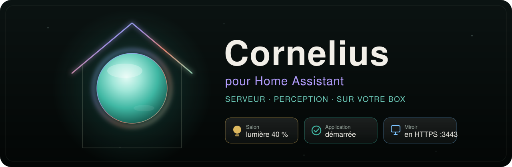
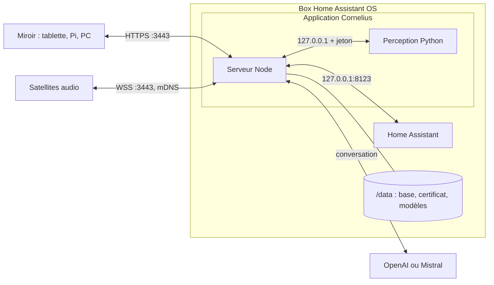

<div align="center">



<h3>Le miroir intelligent de la famille, servi par votre box Home Assistant.</h3>

<p>
  <a href="https://www.youtube.com/@LesFreresPoulain"></a>
</p>

<p>
  
  
  
  
  
  
  <a href="#-licence"></a>
</p>

<p>
  <a href="#-ce-que-fait-lapplication">L’application</a> ·
  <a href="#-ce-quil-faut">Ce qu’il faut</a> ·
  <a href="#-installer">Installer</a> ·
  <a href="#-premiers-pas">Premiers pas</a> ·
  <a href="#-sécurité">Sécurité</a> ·
  <a href="#️-développer">Développer</a> ·
  <a href="#-licence">Licence</a>
</p>

</div>

---

[Cornelius](https://github.com/lfpoulain/Cornelius) transforme un écran, tel quel ou derrière un miroir sans tain, en assistant pour toute la famille : il reconnaît qui se présente, écoute « Cornelius » et répond à la voix, en français. Ce dépôt en fait une **application Home Assistant** (anciennement « add-on ») : le serveur et la perception tournent sur la box, à côté de la domotique, sans ordinateur de plus.

## ✨ Ce que fait l’application

<table>
  <tr>
    <td width="50%" valign="top">
      <h4>🏠 Tout sur la box</h4>
      Le serveur Cornelius et sa perception locale (visages, parole, mot d’appel) tournent dans Home Assistant OS, démarrent avec lui et se mettent à jour depuis la boutique.
    </td>
    <td width="50%" valign="top">
      <h4>🪞 Le miroir où vous voulez</h4>
      Un Raspberry Pi en kiosque, une tablette ou un vieil ordinateur ouvre le miroir en HTTPS sur le réseau local, avec sa caméra, son micro et son haut-parleur.
    </td>
  </tr>
  <tr>
    <td valign="top">
      <h4>💡 La maison à portée de voix</h4>
      Cornelius rejoint Home Assistant par la boucle locale de la box : lumières, prises et capteurs autorisés, sans quitter la maison.
    </td>
    <td valign="top">
      <h4>🔊 Les satellites suivent</h4>
      Les satellites audio ESP32 trouvent Cornelius seuls sur le réseau, comme avec une installation sur un ordinateur.
    </td>
  </tr>
  <tr>
    <td valign="top">
      <h4>💾 Sauvegardé avec la maison</h4>
      Profils, visages, souvenirs et réglages vivent dans le dossier de l’application et partent dans les sauvegardes de Home Assistant.
    </td>
    <td valign="top">
      <h4>📌 Une version, une image</h4>
      Cornelius et ses modules sont fixés à un commit, Node, uv, Python et l’image de base à une version et une empreinte : une même version de l’application installe le même Cornelius.
    </td>
  </tr>
</table>

## 📋 Ce qu’il faut

| | |
|---|---|
| 🏠 **Box** | Home Assistant OS (ou Supervised) en 64 bits : PC x86-64, Raspberry Pi 4 ou 5, Home Assistant Green ou Yellow. Les installations Container et Core n’ont pas d’applications. |
| 🪞 **Miroir** | Un autre appareil avec un navigateur récent, un écran, un micro et un haut-parleur, plus une caméra pour la reconnaissance. |
| 🔑 **Clé** | Une clé OpenAI (ou Mistral) pour la conversation. |
| 🧠 **Mémoire** | De la marge en plus de Home Assistant : la perception analyse la caméra en continu. Sur Raspberry Pi, Green, Yellow, ODROID et Khadas, le mode petite machine s’active seul. |

## 🚀 Installer

[](https://my.home-assistant.io/redirect/supervisor_add_addon_repository/?repository_url=https%3A%2F%2Fgithub.com%2Flfpoulain%2Fcornelius-ha)

1. Ajoutez le dépôt avec le bouton ci-dessus. Sans lui : **Paramètres → Applications**, ouvrez la boutique (bouton d’installation d’une application), menu **⋮ → Dépôts**, et collez `https://github.com/lfpoulain/cornelius-ha`.
2. Ouvrez **Cornelius** dans la boutique et installez-le : la box construit l’image, comptez plusieurs minutes (davantage sur un Raspberry Pi).

### Stable ou bêta

Le dépôt propose deux applications :

| Application | Suit | Pour qui |
|---|---|---|
| **Cornelius** | la dernière [version publiée](https://github.com/lfpoulain/Cornelius/releases) de Cornelius | le miroir de tous les jours |
| **Cornelius (bêta)** | la branche [`beta`](https://github.com/lfpoulain/Cornelius/tree/beta) : fonctions en cours, parfois cassées | essayer avant la publication |

Les deux peuvent tourner ensemble : la bêta a ses propres données et ses propres ports (`3444` en HTTPS, `3001` en interne). La base de l’une ne passe pas dans l’autre. Avec les deux en marche, les satellites audio se connectent au premier qui répond : donnez-leur une adresse fixe.

Les nouvelles versions arrivent dans **Paramètres → Mises à jour**. Le dépôt vérifie chaque jour si Cornelius a publié une version ; la bêta avance quand une nouvelle étape de la branche `beta` est prête à essayer. Activez **Mise à jour automatique** sur la page de l’application pour les installer sans y penser.

> [!NOTE]
> L’application est au stade **expérimental** : elle tourne sur un PC x86-64 sous Home Assistant OS ; l’image aarch64 (Raspberry Pi, Green, Yellow) est construite à chaque version, mais pas encore essayée sur une vraie box. Une application installée comme application locale (`local_apps`) est distincte de celle de la boutique : passer de l’une à l’autre repart d’un Cornelius vide.

## 👋 Premiers pas

1. Onglet **Configuration** : choisissez le **mot de passe de l’administration** (8 caractères au moins, autre que `cornelius`) et, si vous l’avez, la **clé OpenAI**.
2. **Démarrer**, puis activez **Chien de garde** sur la même page.
3. **Ouvrir l’interface web** : l’administration s’ouvre sur `https://homeassistant.local:3443/admin`. Comparez l’empreinte du certificat avec celle du **Journal** de l’application, puis continuez.
4. Sur l’appareil du miroir, ouvrez `https://homeassistant.local:3443/`, autorisez-le avec le mot de passe, puis touchez **Activer la voix**.
5. Dans l’administration, **Caméra et reconnaissance → Emplacement de la caméra → Sur l’appareil qui affiche le miroir**, sauf si une caméra USB est branchée sur la box.
6. **Modules → Home Assistant** : adresse `http://127.0.0.1:8123` et un jeton longue durée, de préférence d’un compte réservé à Cornelius.

Le guide complet est dans l’onglet **Documentation** de l’application ([DOCS.md](cornelius/DOCS.md)) et dans la documentation de Cornelius : [Installer dans Home Assistant](https://github.com/lfpoulain/Cornelius/blob/main/docs/installation/home-assistant.md).

## 🔒 Sécurité

| Droit demandé | Pourquoi |
|---|---|
| **Réseau de l’hôte** | Annonce mDNS pour les satellites, HTTPS sur le réseau local, Home Assistant joignable sur `127.0.0.1:8123`. Il fait passer la note de sécurité de l’application de 5 à 4 (sur 8). |
| **Vidéo** | Seulement pour une caméra USB branchée sur la box ; la caméra du navigateur du miroir n’en a pas besoin. |

- Sur le réseau de l’hôte, `127.0.0.1` est partagé avec Home Assistant et ses autres applications. L’application lance Cornelius avec `CORNELIUS_TRUST_LOOPBACK=0` : un programme de la box a les mêmes droits qu’un appareil du réseau local et n’ouvre ni le miroir ni l’administration sans le mot de passe. La perception se connecte par la boucle locale avec son jeton.
- Le mot de passe et la clé OpenAI passent au serveur par l’environnement de s6 ; la perception ne les reçoit pas dans le sien.
- Les sauvegardes de Home Assistant contiennent la base (jeton Home Assistant, signatures des visages, souvenirs) et les options (mot de passe, clé OpenAI) : gardez-les à l’abri.
- N’ouvrez jamais le port `3443` sur votre box Internet : Cornelius refuse les adresses publiques.

## 🧱 Comment c’est construit

| Chemin | Rôle |
|---|---|
| [`repository.yaml`](repository.yaml) | Description du dépôt, lue par Home Assistant. |
| [`cornelius/config.yaml`](cornelius/config.yaml) | L’application : architectures, réseau, chien de garde, sauvegarde, options. |
| [`cornelius/source.env`](cornelius/source.env) | Les commits de Cornelius et de cornelius-modules contenus dans l’image, tenus par `scripts/bump.sh`. |
| [`cornelius/Dockerfile`](cornelius/Dockerfile) | L’image : base Debian de Home Assistant, Node 24 de l’image officielle, Python 3.12 par uv, Cornelius et cornelius-modules aux commits de `source.env`, modèles des visages, de la parole et du mot d’appel. |
| [`cornelius/rootfs/etc/s6-overlay/`](cornelius/rootfs/etc/s6-overlay) | Les services s6 : `init-cornelius` (options, ports, nom de la box, jeton de la perception, modèles), `cornelius` (serveur) et `perception`. |
| [`cornelius/DOCS.md`](cornelius/DOCS.md) | L’onglet **Documentation** de l’application. |
| [`cornelius/translations/`](cornelius/translations) | Les libellés des options, en français et en anglais. |
| [`cornelius_beta/`](cornelius_beta) | La bêta. Seuls `config.yaml` (nom, version, ports), `source.env`, `README.md` et `CHANGELOG.md` lui sont propres ; le reste est recopié de `cornelius/` par `scripts/sync-beta.sh`. |
| [`scripts/`](scripts) | `bump.sh` fait suivre une version de Cornelius à un canal ; `sync-beta.sh` recopie la bêta. |
| [`.github/workflows/`](.github/workflows) | `update.yml` suit les versions de Cornelius ; `build.yml` vérifie chaque modification. |
| [`.github/assets/`](.github/assets) | La bannière, l’icône et le logo, en SVG. |



## 🛠️ Développer

**Suivre une version de Cornelius.** L’action [Mise à jour de Cornelius](.github/workflows/update.yml) s’en charge : chaque jour pour le canal stable, et à la main (**Actions → Mise à jour de Cornelius → Run workflow**) pour l’un ou l’autre canal, avec un tag, une branche ou un commit au choix. Elle lance `scripts/bump.sh`, construit les images amd64 et aarch64, puis publie sur `main`. La même chose en local, avec [gh](https://cli.github.com/) connecté :

```sh
scripts/bump.sh stable          # dernière release de Cornelius
scripts/bump.sh stable v0.2.0   # ou ce tag
scripts/bump.sh beta            # tête de la branche beta
scripts/bump.sh beta a15463f    # ou ce commit
```

Le script change `source.env`, `version` dans `config.yaml` et ajoute une entrée au `CHANGELOG.md` : c’est la nouvelle version qui propose la mise à jour dans Home Assistant. Le canal stable porte la version de Cornelius (`0.2.0`) ; pour une correction de l’application seule, ajoutez un suffixe à la main (`0.2.0-1`). La bêta porte la version de la branche et son commit (`0.2.0-beta.ebea79d`).

**Modifier l’application.** Changez les fichiers de `cornelius/`, puis lancez `scripts/sync-beta.sh` pour recopier la bêta ; l’action [Construction](.github/workflows/build.yml) refuse une bêta oubliée.

**Mettre à jour les briques.** Node, uv et l’image de base sont épinglés par version et empreinte (`@sha256:`). Pour en changer, relevez la nouvelle empreinte :

```sh
docker buildx imagetools inspect ghcr.io/home-assistant/base-debian:trixie-2026.10.3
```

**Construire l’image**, depuis `cornelius/` :

```sh
docker buildx build --platform linux/amd64 --load -t local/cornelius-ha .
```

Hors de Home Assistant, `bashio::config` n’a pas de Supervisor à interroger : pour lancer l’image, remplacez `init-cornelius/run` par un script qui écrit lui-même les variables.

**Essayer sur la box.** Copiez `cornelius/` dans le partage **`local_apps`** de la box (application **Samba share**) : après **⋮ → Rechercher des mises à jour**, il apparaît dans la boutique, section « Local apps ». C’est une application distincte de celle du dépôt, avec ses propres données. Après une modification du `Dockerfile` ou des scripts, **Reconstruire** sur la page de l’application (ou `ha apps rebuild --force local_cornelius` en SSH). Après une modification de `config.yaml`, d’abord **⋮ → Rechercher des mises à jour** dans la boutique, puis **Mettre à jour** si la version a changé, sinon **Reconstruire**.

## 📄 Licence

- Les fichiers de ce dépôt (Dockerfile, scripts, configuration, visuels) sont sous [licence MIT](LICENSE).
- **Cornelius**, que l’image télécharge et contient, est sous [PolyForm Noncommercial 1.0.0](https://github.com/lfpoulain/Cornelius/blob/main/LICENSE) : usage non commercial seulement. Sa licence et ses notices sont dans l’image, dans `/app`.
- [cornelius-modules](https://github.com/lfpoulain/cornelius-modules) est sous licence MIT.

<div align="center">
<sub>Fait avec soin par <a href="https://www.youtube.com/@LesFreresPoulain">Les Frères Poulain</a>.</sub>
</div>
